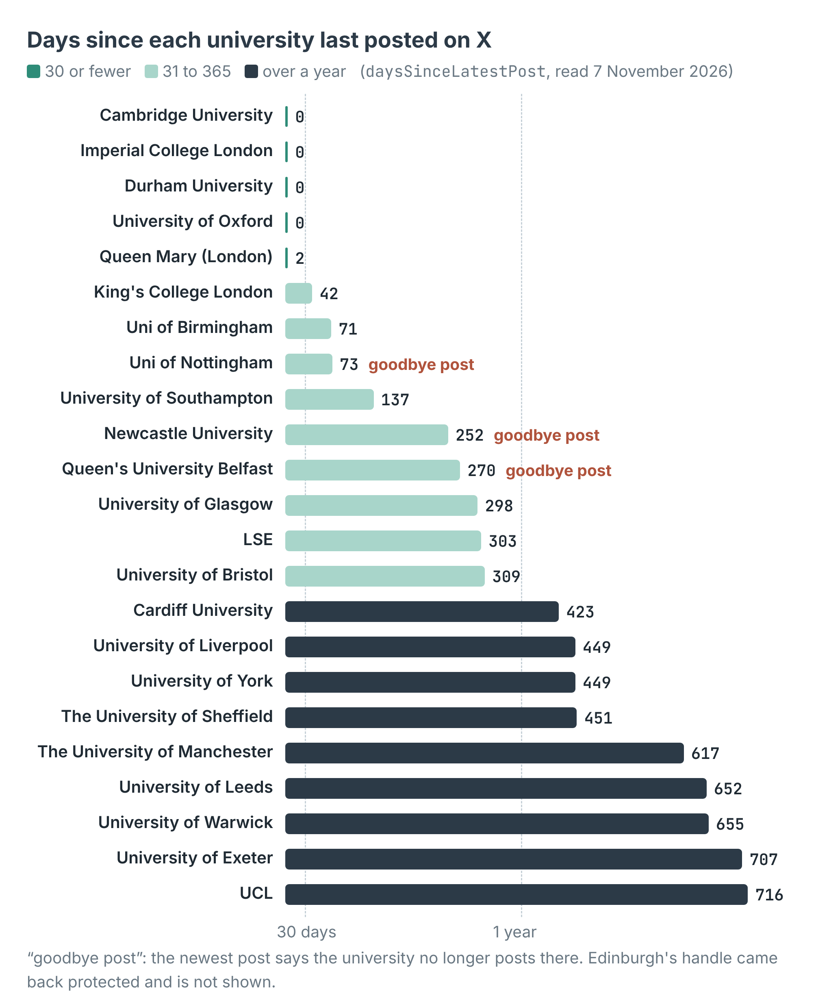
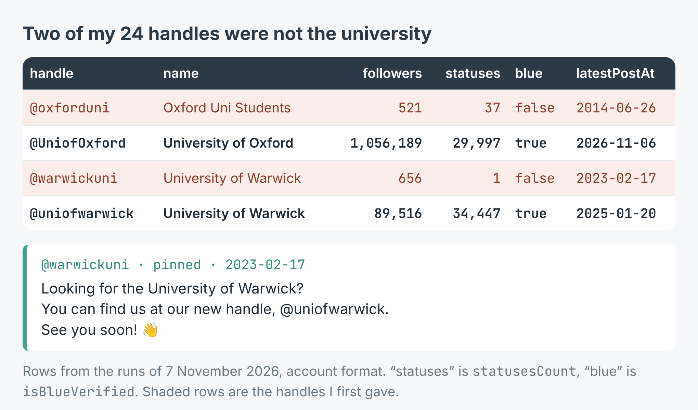

# X (Twitter) account checker: which accounts in a list are still active

Give it a list of X handles. It reads each public profile once and prints the
account's followers, when it last posted, how many days ago that was, a status
(active, quiet, or silent over a year) and the first line of its newest post,
flags a newest post that is a goodbye or points to a new handle, and writes
every handle to `accounts.csv`.

These scripts call [X (Twitter) Scraper – Profile Posts & Stats](https://apify.com/simple.actor/x-profile-posts)
on Apify. No X login, no cookies, no API key, no browser.



The write-up, with a real run on the 24 Russell Group universities, is
[How to check which X (Twitter) accounts in a list are still active](https://simple-actor.github.io/check-which-x-twitter-accounts-still-active-uk-universities/)

## Run it

You need an [Apify](https://apify.com) account and its API token, from
Console → Settings → API & Integrations.

**Node** (20 or newer):

```bash
cd node
npm install
APIFY_TOKEN=your_token node check-accounts.mjs warwickuni QUBelfast
```

**Python** (3.10 or newer):

```bash
cd python
python -m venv .venv && . .venv/bin/activate
pip install -r requirements.txt
APIFY_TOKEN=your_token python check_accounts.py UniofNottingham EdinburghUni
```

Give as many handles as you like, with or without the `@`. The Node script on
two handles, on 7 November 2026:

```
@warwickuni (University of Warwick): 656 followers, last post 2023-02-17 (1358 days), silent over a year, GOODBYE POST
    "Looking for the University of Warwick?"
@QUBelfast (Queen's University Belfast 🎓, blue): 59,835 followers, last post 2026-02-09 (270 days), quiet, GOODBYE POST
    "We are currently not using X (formerly Twitter). This decision reflects our commitment to "

wrote 2 handles to accounts.csv
```

And the Python script:

```
@UniofNottingham (Uni of Nottingham #WeAreUoN): 90,765 followers, last post 2026-08-25 (73 days), quiet, GOODBYE POST
    "We no longer post on this account, but it remains active for monitoring purposes. Please f"
https://x.com/EdinburghUni: protected (https://x.com/EdinburghUni is protected — its posts are visible only to approved followers, and cannot be read without a login.)

wrote 2 handles to accounts.csv
```

## Check the handle first

`@warwickuni` above is not the university's account: it has one post, pinned,
pointing to `@uniofwarwick`, which has 89,516 followers. In the post's run,
`@oxforduni` turned out to be an account called "Oxford Uni Students" with 521
followers, while the university is `@UniofOxford` with 1,056,189. A wrong
handle that exists is read and charged like any other, so look at `name`,
`followers` and `statusesCount` before trusting the dates.



## What a row looks like

With `outputFormat: "profile"` the scraper returns one row per handle.
[`sample-output.json`](sample-output.json) holds four real rows from the run:
Queen's University Belfast, `@uniofwarwick`, the old `@warwickuni`, and the
`protected` row for `@EdinburghUni`. Image links in them are X's and may stop
working.

The fields you will use most:

| Field | What it holds |
|---|---|
| `userName`, `name`, `followers`, `statusesCount` | The account: what to check a handle against |
| `latestPostAt`, `daysSinceLatestPost` | When it last posted or replied, and how many whole days before the read |
| `posts` | Its latest posts (up to five), each with `text`, `timestamp`, `isPinned` and counts |
| `isBlueVerified`, `verifiedType`, `website` | Badges and the profile's link |
| `timelineWithheld` | `true` when X showed the profile but none of its posts, on two reads |
| `error`, `errorDescription` | Set when a handle could not be read: `not_found`, `not_available`, `protected`, `bad_input`, `timeline_withheld` |

## What it costs

$0.0005 per profile read, nothing per post. A handle that can't be read
(missing, suspended, protected) is never charged. The 23 accounts read in the
post's run cost $0.0115; checking 300 accounts costs $0.15.

## Where it falls short

- **The latest five posts only.** That's what X shows a logged-out visitor. It
  says when an account last posted, not how often it posts.
- **Reposts don't count.** The timeline carries an account's own posts and
  replies, so an account that only reposts reads as silent.
- **A goodbye resets the date.** Nottingham's newest post says it no longer
  posts there, and it reads 73 days. The scripts' goodbye match is a keyword
  test; read the `note` column yourself.
- **Protected accounts can't be read.** You get the `protected` row and nothing
  else.
- **A wrong handle can be a real account.** It is read and charged; check it.
